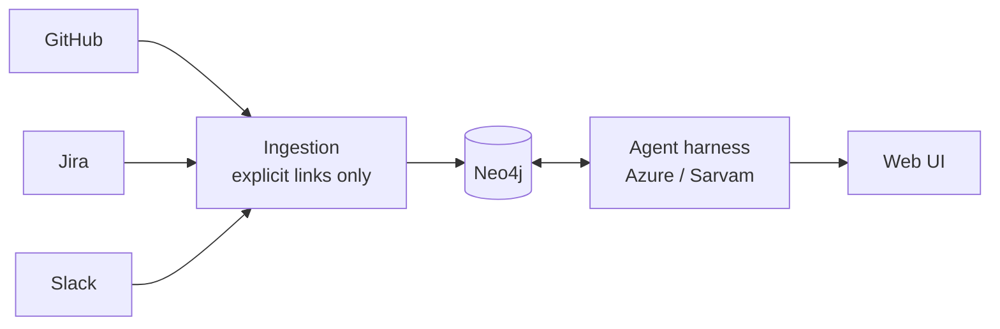

# Engineering Memory

Connect GitHub, Jira and Slack into one **evidence graph**, then ask *why is this code like this?*, *debug this error*, or *is it safe to change this?* and get an answer where every claim links to its source — or an honest "not established".



## What is different

- **Edges are evidence, not guesses.** A link exists only if a source stated it (PR contains commit, reply-to, or an explicit `PAY-412` / PR URL / Slack permalink in text). Each edge records its `origin` and a source locator. No keyword or timing inference.
- **The LLM does not get free rein over the database.** It picks from validated, read-only, capped graph tools; ids must come from evidence already seen; a guarded text2cypher path exists for complex questions and is only used to *find* ids, which are then re-read through trusted templates.
- **Citations are verified in code.** A cited URL that was not retrieved is dropped and confidence is capped. "Not established" is a first-class answer.
- **Demo and live share one path.** Demo data is native-shaped API payloads served to the real clients and mappers.

More: [docs/architecture.md](docs/architecture.md) · scope and acceptance criteria: [SPEC.md](SPEC.md)

## Run it

```bash
uv sync
cp .env.example .env          # add an LLM key (AZURE_FOUNDRY_* or SARVAM_API_KEY)
docker compose up -d          # Neo4j on bolt://localhost:7688 (+ a throwaway test DB on 7689)
uv run hackfront serve        # API on http://127.0.0.1:8000
cd web && npm ci && npm run dev   # the workbench UI on http://localhost:3000 (proxies /api to :8000)
```

Open http://localhost:3000, **Connections → Load demo data** (or `uv run hackfront demo`), open `src/payments/gateway_client.py` and **click the `MAX_RETRIES = 3` line**: the agent investigates why, and each claim is marked supported / inferred / unknown with quotes verified against the sources. If port 3000 is taken, run `npm run dev -- --port 3100` and start the API with `HACKFRONT_ORIGINS=http://localhost:3100`.

Terminal alternative: `uv run hackfront ask "Why are gateway retries capped at 3?"`. Questions the demo can answer: *Why are gateway retries capped at 3?* · *Why is the session TTL 15 minutes?*; and one it cannot (*Why did we choose Redis for the session cache?*), where the agent should say "not established".

## Connect your own sources

Set targets in the UI (or `workspace.json`, see `workspace.example.json`) and tokens in `.env`; then **Sync sources** or `uv run hackfront sync`.

| Source | Needs |
|---|---|
| GitHub | `GITHUB_TOKEN` (fine-grained, read-only: Contents, Pull requests, Metadata) + owner and repo names |
| Jira Cloud | site URL, `JIRA_EMAIL` + `JIRA_API_TOKEN`, project keys |
| Slack | `SLACK_BOT_TOKEN` with `channels:history` (`groups:history` for private), bot invited to channels; `workspace` = your Slack subdomain |

LLM providers: `LLM_PROVIDER=azure|sarvam`, `LLM_MODEL` optional; switchable per question in the UI. Sarvam uses `https://api.sarvam.ai/v1/`.

## Test

```bash
uv run pytest tests/ingest tests/agent tests/api -q   # needs `docker compose up -d` (test Neo4j on 7689)
uv run pytest tests/e2e -q                             # real LLM calls; skips providers without keys
```

Neo4j tests wipe `Artifact` nodes in the **test** database only.

## Layout

`src/hackfront/ingest` contracts, sources (github/jira/slack), extraction (deterministic + text links), Neo4j storage, sync, demo data · `src/hackfront/agent` providers, harness, flow, verification · `src/hackfront/api` FastAPI · `web/` static UI · `research/` background papers.

## Known limits

- Local single-user tool: the API has no login and binds to 127.0.0.1; do not expose it. Run the agent with a read-only Neo4j user in any shared setup.
- Sync is a bounded full backfill (20 pages per stream) through idempotent writes, not an incremental cursor; the UI flags incomplete streams. Text-derived edges are rebuilt from current text on every write; deleted source records are not removed from the graph.
- Real-LLM behaviour (Azure, Sarvam) is covered by `tests/e2e` and needs your keys; unit tests use scripted models.
