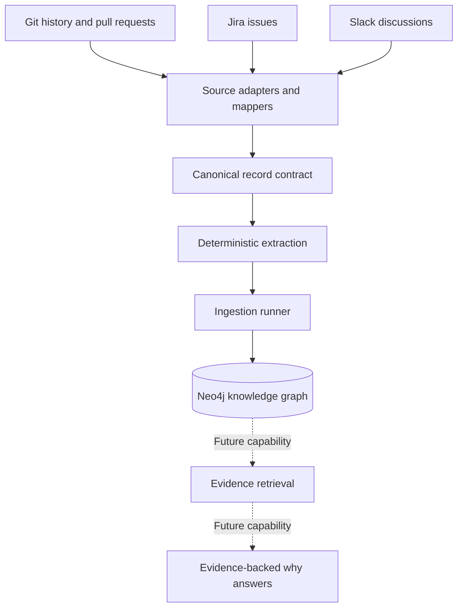

# Engineering Memory

**Building a source-grounded engineering knowledge graph to help explain why code is the way it is.**

Engineering decisions are scattered across Git history, pull requests, issue trackers, and team discussions. Engineering Memory is designed to preserve those artifacts, normalize them into a common record format, and connect explicitly linked evidence in Neo4j.

> **Current scope:** The ingestion foundation. Evidence retrieval, reasoning, and natural-language "why" answers are future capabilities, not claims of the current implementation.

## The problem

When investigating a codebase, engineers often need to understand more than what a function does. They need to discover which change introduced it, which pull request reviewed it, which issue motivated the work, and which discussion recorded the decision.

Those facts are spread across multiple systems. Engineering Memory aims to make their connections traversable while preserving the source evidence behind each connection.

## Architecture



Solid arrows represent the intended ingestion flow. Dotted arrows represent future product capabilities.

## How ingestion works

1. **Read source artifacts.** Adapters handle provider-specific records and pagination.
2. **Normalize records.** Source mappers convert provider payloads into a versioned, source-neutral contract.
3. **Extract explicit facts.** Deterministic extraction preserves identifiers, timestamps, paths, change metadata, source locators, and explicit references.
4. **Persist the graph.** The ingestion runner coordinates bounded processing and Neo4j writes.
5. **Preserve provenance.** Records and relationships retain source information so stored connections can be traced back to their origin.

## Relationship-building principles

- **Stable identity:** canonical IDs are namespaced by provider, workspace, record type, and native ID.
- **Explicit links first:** create source relationships when the source provides an explicit reference.
- **No invented causality:** a shared keyword or nearby timestamp is not proof that one decision caused a code change.
- **Traceable evidence:** retain provenance and source locators where available.
- **Replay safety:** stable IDs and idempotent upserts are intended to prevent duplicate graph entities and relationships.
- **Controlled semantics:** semantic extraction remains disabled by default pending a separately approved policy.

See [Relationship-building system](docs/relationship-building.md) for the detailed relationship rules and requirements gap analysis.

## Current implementation status

The repository contains the canonical record contract, deterministic extraction, GitHub/Jira/Slack source components, an ingestion runner, a Neo4j writer and schema, fixtures, and tests.

| Capability | Status |
|---|---|
| Canonical records and provenance | Implemented; unit tests passed |
| Deterministic extraction | Implemented; unit tests passed |
| Fixture-backed source components | Present; unit tests passed |
| Bounded ingestion and cursor handling | Implemented; unit tests passed |
| Neo4j graph persistence | Implemented in code; live integration result must be verified |
| Full commit-to-PR-to-issue-to-discussion evidence chain | Requires end-to-end verification |
| Evidence-backed natural-language answers | Not implemented in the current ingestion scope |
| Supersession detection and reasoning | Not demonstrated by the current implementation |

The current unit-test baseline was **32 passing tests**. This does not establish that live Neo4j integration tests pass or that every acceptance criterion is satisfied.

The product specification in `SPEC.md` is a draft. Its acceptance criteria should be verified before declaring the ingestion slice complete.

## Getting started

Use Python from the `ingestion` directory.

Run unit tests:

```bash
python -m unittest discover -s tests/unit -v
```

### Neo4j integration tests

Configure the following environment variables locally:

- `NEO4J_URI`
- `NEO4J_USERNAME`
- `NEO4J_PASSWORD`
- `NEO4J_DATABASE` (optional)

Then run:

```bash
python -m unittest discover -s tests/integration -v
```

**Important:** Integration tests delete `Artifact` nodes during setup and teardown. Use a disposable test database only, never a production or shared database. Do not commit credentials or secret-bearing environment files.

For fuller instructions, see [`ingestion/TESTING.md`](ingestion/TESTING.md), if present.

## Repository guide

- [`SPEC.md`](SPEC.md) — draft product specification and acceptance criteria
- [`AGENTS.md`](AGENTS.md) — repository workflow instructions
- [`ingestion/`](ingestion/) — ingestion package, adapters, extraction, storage, and tests
- [`docs/relationship-building.md`](docs/relationship-building.md) — relationship model, implemented rules, and gaps against the brief

## Scope boundary

The current ingestion slice builds a provenance-aware graph from explicit source facts. It does not yet establish that a particular discussion caused a code change, infer missing relationships, detect superseded decisions, or generate final answers to "why" questions.

Those capabilities require separate retrieval and reasoning work, clear evidence contracts, and appropriate validation.
