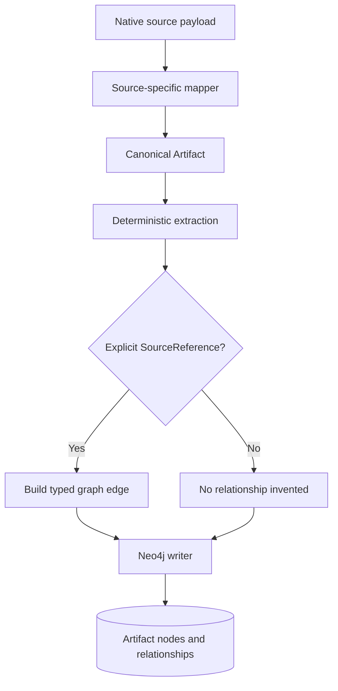
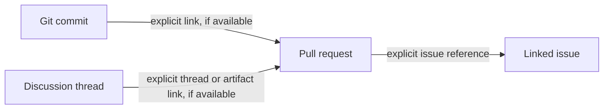
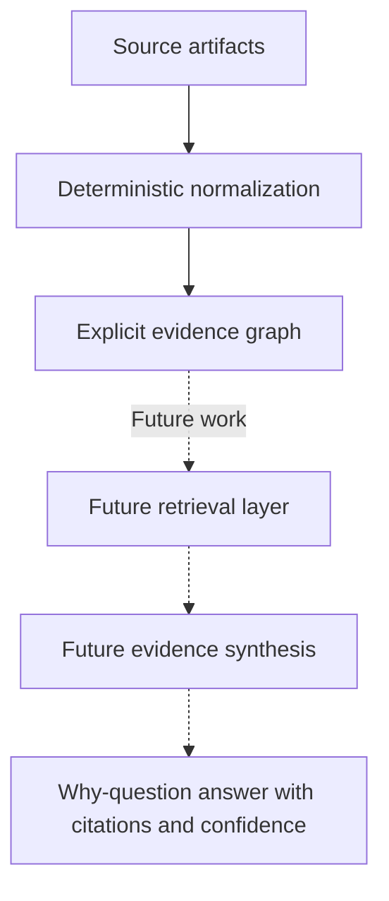

# Relationship-Building System

## 1. Purpose

The relationship-building system connects engineering artifacts so that later components can traverse evidence across code changes, pull requests, issues, and discussions.

The current ingestion design prioritizes **explicit, source-grounded links**. It does not treat a plausible connection as a verified fact.

The scope boundary in `SPEC.md` is important: this slice ends at durable graph ingestion. It does not implement the complete "Why The Code Is Like This" answering and reasoning experience.

## 2. Data flow

The mapper is responsible for understanding provider-specific field names and mapping explicit source links into the canonical contract. The extraction layer preserves source-grounded values; it is not a semantic reasoning engine. The writer persists canonical artifacts and their references in Neo4j.

## 3. Rules followed so far

### Rule 1: Use canonical identity

Each source artifact has a source identity containing its provider, workspace, record type, and native source ID.

The canonical ID is namespaced:

`provider:workspace:record_type:native_id`

The provider's native ID remains available as `source_id`. This prevents records from different providers or workspaces from accidentally sharing identity simply because their native IDs look alike.

### Rule 2: Keep provider details at the boundary

Source mappers understand provider-specific payload shapes. Core ingestion and graph persistence consume canonical records instead of relying directly on GitHub, Jira, or Slack field names.

This separation makes source adapters replaceable and keeps the contract technology-neutral.

### Rule 3: Create relationships from explicit references

The canonical contract uses `SourceReference` to represent a target identity, relationship kind, and source locator.

The current relationship enum defines:

| Relationship kind | Intended meaning |
|---|---|
| `PARENT_OF` | Parent-child relationship |
| `CHANGES` | One artifact changes another entity |
| `REFERENCES` | Explicit reference to another artifact |
| `CONTAINS` | One artifact contains or groups another |
| `REPLIES_TO` | A message replies to another message |

These names do not prove that every relationship is already used consistently. The source mappers and fixtures must be inspected and tested to establish actual usage and direction.

### Rule 4: Preserve provenance

Records include provenance fields such as source URI, locator, observation time, adapter version, and optional payload reference or hash.

Deterministic extracted values also carry a locator and extraction version. These fields help trace a normalized value back to its source.

Provenance supports auditability; it does not by itself prove that a source statement is correct or causal.

### Rule 5: Use stable, idempotent graph writes

The Neo4j writer uses canonical IDs for artifact identity and stable IDs for relationships. It uses `MERGE` to support repeated writes without intentionally creating duplicate logical entities and edges.

This is the implementation strategy. The actual guarantee must be verified by integration tests against a disposable Neo4j database.

### Rule 6: Do not promote guesses into facts

The deterministic extraction design retains explicit references rather than interpreting free text as causal evidence. Semantic extraction is specified as disabled by default until a separate policy is approved.

For example, a commit and a Slack message mentioning the same feature should not automatically be linked as cause and effect unless a reliable explicit link or separately approved evidence process supports that claim.

## 4. Example relationship flow

Consider these artifacts:

This is an illustrative target evidence chain, not a claim that every link is currently available in every provider payload or verified in the running graph.

Each edge should preserve its relationship type and source provenance where available. The graph should not silently fill missing links merely to make the chain appear complete.

## 5. What is implemented versus what remains

The current specification is a draft. The statuses below distinguish code that exists from behavior that still needs runtime or acceptance-level verification.

| Requirement or capability | Current status | Evidence needed or next step |
|---|---|---|
| Canonical, versioned source-neutral record envelope | Contract implemented and unit-tested | Continue validating provider mappings |
| Stable, namespaced source identity | Implemented in the contract | Verify identity behavior across representative fixtures |
| Deterministic extraction with locators and versions | Implemented and unit-tested | Validate extracted values against source payloads |
| Explicit typed references | Contract and writer implemented | Verify every mapper's relationship type and direction |
| Neo4j persistence and uniqueness constraints | Code implemented | Run integration tests against a disposable database |
| Idempotent replay | Logic and integration test exist | Execute tests against real Neo4j and verify graph counts |
| Commit-to-PR-to-issue-to-thread evidence chain | Not yet proven end-to-end | Add assertions for each expected node and exact edge |
| Stub artifact upgraded when its full record arrives | Behavior appears supported by writer design | Add a direct integration test |
| Partial updates preserve previously known values | Needs review | Test null and missing-field update behavior |
| Incremental cursors and structured run summaries | Implemented and unit-tested | Verify persistence failure and replay behavior end-to-end |
| Semantic relationship inference | Disabled/not implemented in this slice | Approve a separate policy and evidence contract first |
| Supersession of earlier decisions | Not demonstrated | Define decision identity, valid time, supersession evidence, and query behavior |
| Natural-language "why" answers with evidence and confidence | Not implemented in this slice | Build retrieval and reasoning as a separate product layer |

## 6. Important relationship-design questions

### Commit ancestry

The relationship enum includes `PARENT_OF`, while the GitHub commit mapper currently maps parent commit references using `REFERENCES`.

That may be an intentional simplification, but it loses the distinction between commit ancestry and a generic reference. The team should decide on one convention and document edge direction before building queries that depend on it.

### Pull request base, head, and merge commit

A pull request's source branch, target branch, and merge commit represent different concepts. Their relationship kinds and directions should be explicit and consistent so future queries do not confuse "contains", "references", and "changes".

### Missing links

An absent explicit reference means the source has not provided a verified relationship through the current deterministic path. It does not mean that no real-world relationship exists.

Future retrieval or semantic processing may propose candidates, but inferred links should remain distinguishable from source-asserted facts.

### Updates and stub promotion

The writer can create stub nodes for referenced artifacts before their full payloads arrive. A direct test should prove that a later full artifact promotes the stub without losing its existing edges.

The writer also uses property-map updates. The team should test whether nullable fields in a later record can overwrite previously known properties, and define whether missing, unknown, and intentionally cleared values are distinct.

## 7. Relationship-building versus reasoning

The ingestion layer creates a trustworthy evidence foundation. It should not claim to answer why a decision was made merely because related records exist.

A future answering system should retrieve relevant graph paths, inspect source evidence, distinguish explicit facts from inference, handle contradictory or superseded decisions, and decline to answer when evidence is insufficient.

## 8. Validation checklist

- [ ] Run the full unit-test suite.
- [ ] Configure a disposable Neo4j database.
- [ ] Run integration tests and record the actual result.
- [ ] Replay the same fixture batch twice and compare logical node and edge counts.
- [ ] Verify the exact commit-to-PR-to-issue-to-discussion chain using explicit assertions.
- [ ] Test stub promotion and edge preservation.
- [ ] Test partial updates and null-valued properties.
- [ ] Inspect run summaries for cursor progress, counts, versions, and redacted failures.
- [ ] Confirm no credentials or sensitive message content are committed.
- [ ] Keep the semantic extraction boundary disabled until its policy is approved.

## References

- [`../SPEC.md`](../SPEC.md) — draft specification, functional requirements, non-goals, and acceptance criteria.
- [`../AGENTS.md`](../AGENTS.md) — repository workflow instructions.
- [`../ingestion/`](../ingestion/) — ingestion implementation and tests.
